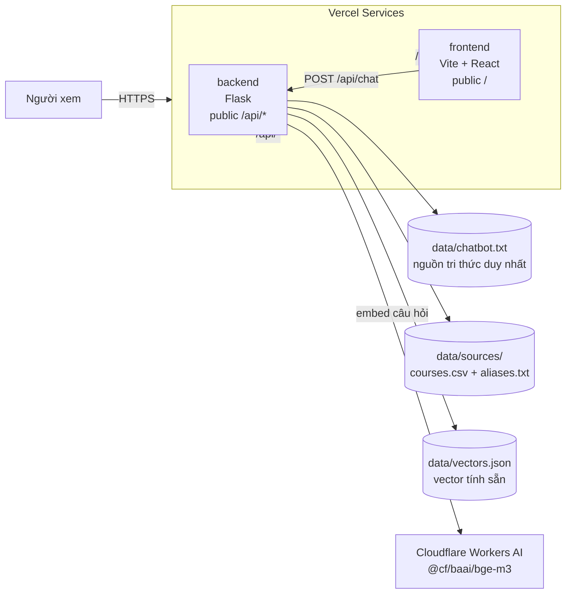
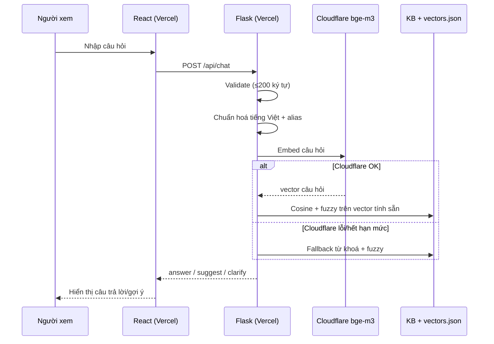
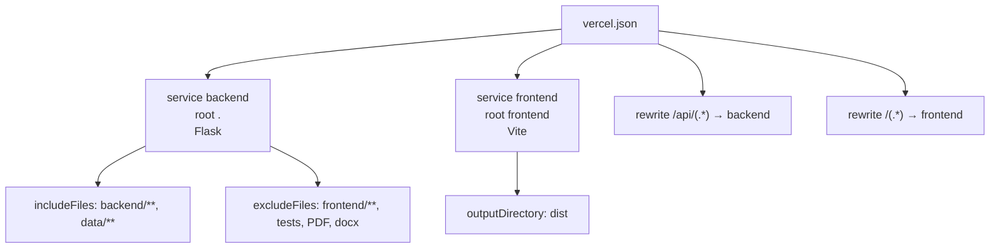
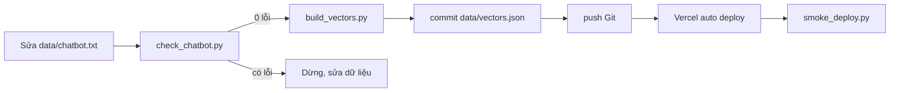

# Sơ đồ đồ án — Chatbot giới thiệu bản thân

**Cập nhật**: 2026-11-17
**Trạng thái**: đã deploy production trên Vercel Services + Cloudflare Workers AI
**URL production**: https://chatbot-gamma-gilt-33.vercel.app

**Công nghệ & thư viện**: xem [TECH_STACK.md](./TECH_STACK.md)

---

## 1. Kiến trúc tổng quan



### Thành phần

| Thành phần | Vai trò |
|-----------|---------|
| `frontend/` | React + Vite, giao diện chat, hiển thị gợi ý/menu chủ đề, health banner |
| `backend/` | Flask API, KB engine, validation, fallback từ khoá/fuzzy |
| `data/chatbot.txt` | Nguồn tri thức viết tay duy nhất (`qa`, `doc`, `fact`) |
| `data/sources/courses.csv` | Danh sách môn học — nguồn số liệu học tập |
| `data/sources/aliases.txt` | Bí danh câu hỏi (oop, ctdl, xstk…) |
| `data/vectors.json` | Vector Cloudflare tính sẵn, kèm hash/model/dim |
| `scripts/` | Kiểm tra dữ liệu, build vector, tune ngưỡng, smoke test |
| Cloudflare Workers AI | Chỉ tạo embedding cho câu hỏi người dùng |

---

## 2. Luồng xử lý một câu hỏi



**Nguyên tắc**: câu hỏi hợp lệ không bao giờ trả HTTP 500 hoặc “không biết” chỉ vì Cloudflare lỗi.

---

## 3. Cấu trúc thư mục

```text
chatbot/
├── api/                      # Entrypoint local / dự phòng (không dùng trong services mode)
│   ├── chat.py
│   └── health.py
├── app.py                    # Entrypoint Flask ở root cho Vercel service
├── backend/
│   ├── app.py                # Flask app, routes /api/chat, /api/health
│   ├── assistant.py          # answer / suggest / clarify
│   ├── kb_engine.py          # cosine + fuzzy, nạp vector tính sẵn
│   ├── embedding_provider.py # Cloudflare / Ollama / none
│   ├── vector_store.py       # đọc/ghi/kiểm tra data/vectors.json
│   ├── source_store.py       # đọc nguồn + courses + aliases, không LangChain
│   ├── health.py             # /api/health
│   ├── source_format.py      # parser/validator CHATBOT-SOURCE v1
│   ├── chatbox.py            # legacy Ollama/FAISS (giữ rollback)
│   └── tests/
├── data/
│   ├── chatbot.txt           # nguồn chuẩn
│   ├── sources/
│   │   ├── courses.csv
│   │   └── aliases.txt
│   ├── inbox/                # tệp chờ nạp
│   └── vectors.json          # vector Cloudflare (commit)
├── frontend/
│   └── src/
│       ├── App.tsx
│       └── lib/
│           ├── config.ts     # base URL /api
│           ├── health.ts     # gọi /api/health
│           └── chatClient.ts
├── scripts/
│   ├── check_chatbot.py
│   ├── build_vectors.py
│   ├── tune_weights.py
│   ├── smoke_deploy.py
│   └── check_secrets.py
├── specs/008-vercel-cloudflare-deploy/
├── vercel.json               # Services: backend + frontend
├── requirements.txt          # dependency tối giản cho deploy
└── .python-version           # 3.12
```

---

## 4. Cấu hình Vercel Services



**Không có service binding**: frontend gọi backend từ trình duyệt qua public path `/api/*`; backend gọi Cloudflare (dịch vụ ngoài), không gọi service nội bộ.

---

## 5. Quy trình cập nhật dữ liệu



Nếu quên bước build vector, `/api/health` báo `source_hash_matches=false` và chatbot dùng fallback từ khoá.

---

## 6. Trạng thái hiện tại

| Hạng mục | Trạng thái |
|----------|-----------|
| Vercel Services (`backend` + `frontend`) | ✅ deployed |
| URL production | ✅ https://chatbot-gamma-gilt-33.vercel.app |
| `/api/health` | ✅ `status: ok`, `280` vector, `source_hash_matches: true` |
| Cloudflare env trên Vercel | ✅ đã set Production + Preview |
| `data/vectors.json` | ✅ đã build bằng Cloudflare `@cf/baai/bge-m3` |
| Chat trả lời trực tiếp | ✅ GPA và OOP trả `answer` đúng |
| Tuning `HIGH`/`MID`/`FUZZY_W` | ✅ đã chạy; giữ `0.78 / 0.55 / 0.2` |
| WAF rate limit 30/phút/IP | ⚠️ cần kiểm tra/publish trên dashboard |

### Đã sửa lỗi chat chỉ trả gợi ý

Nguyên nhân là `kb_engine` mặc định model `bge-m3` trong khi `vectors.json` dùng
`@cf/baai/bge-m3`, nên chỉ mục bị coi là không khớp và rơi về fallback từ khoá. Đã sửa
`embedding_provider.model_name()` để mặc định theo provider (`cloudflare` →
`@cf/baai/bge-m3`, `ollama` → `bge-m3`) và thêm test hồi quy. Smoke test production hiện
trả `answer` cho GPA/OOP.

---

## 7. Việc cần làm tiếp

- [x] Chạy `tune_weights.py` trên vector Cloudflare, chọn lại `HIGH`/`MID`/`FUZZY_W`.
- [x] Cập nhật env Vercel và redeploy.
- [x] Chạy `smoke_deploy.py` đạt T1–T3.
- [ ] Tạo/publish WAF rate limit: `POST /api/chat`, 30 request/60 giây/IP → 429.
- [ ] Thu hồi token Cloudflare cũ đã từng bị lộ; chỉ giữ token mới trong `.env`/Vercel.
- [ ] Gắn custom domain (nếu muốn) tại Vercel → Domains.
- [x] Commit + push toàn bộ thay đổi và `data/vectors.json` để review.

---

## 8. Ghi chú bảo mật

- Không commit `.env`, `.env.local`, token Cloudflare.
- Chỉ `CF_ACCOUNT_ID`/`CF_API_TOKEN` nằm trong Vercel Environment Variables và file `.env` local đã gitignore.
- `scripts/check_secrets.py` dùng để quét token vô tình lọt vào repo/frontend.
- Nhánh `ollama-version` giữ bản Docker/Ollama để rollback.
